<p align="center">
  <br>
  <h1 align="center">NexaBank</h1>
  <p align="center">A compact digital-banking platform: a Spring Boot REST API and an Angular back-office console in one repository.</p>
</p>

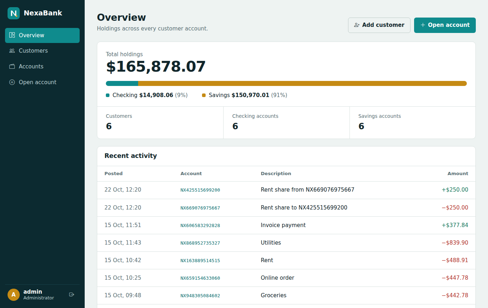

## What it does

| Area | Capabilities |
| --- | --- |
| Customers | Create, search, edit and delete customers; see every account a customer holds |
| Accounts | Open checking accounts (with overdraft limit) and savings accounts (with annual rate) |
| Money movement | Deposits, withdrawals and transfers, each recorded as a ledger entry with the resulting balance |
| Statements | Paginated, newest-first statement per account |
| Insight | Dashboard with total holdings, checking/savings split and recent activity |
| Access control | JWT sign-in with two roles: `ADMIN` (everything) and `TELLER` (no deletions) |

Design choices worth knowing about:

- **Money is `BigDecimal`** (scale 2) end to end, never floating point.
- **Rules live in the domain.** `Account.withdraw()` enforces overdraft, suspension and balance checks, so no service can bypass them.
- **Transfers are race-safe.** Both accounts are locked with `PESSIMISTIC_WRITE` in a stable order, which prevents double spending and deadlocks.
- **Errors are RFC 7807 problem documents** with a field map for validation failures.

## Architecture

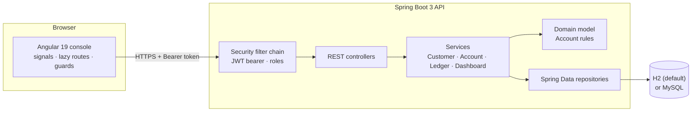

### Transfer flow

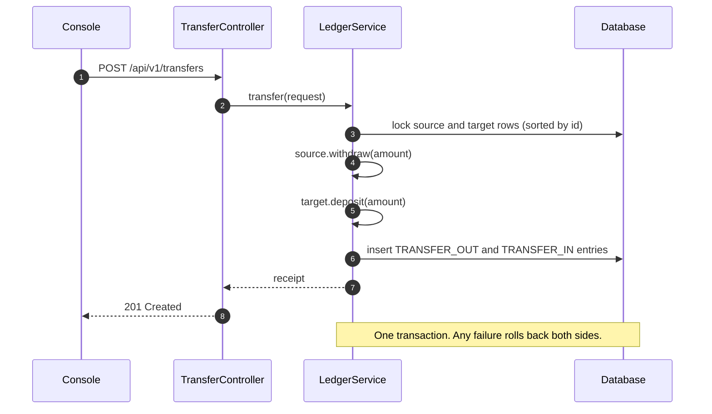

### Sign-in flow

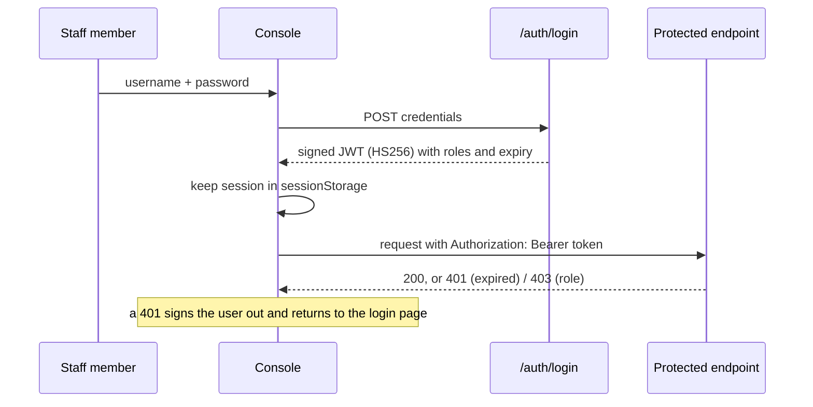

## Quick start

**Requirements:** JDK 17+, Node 20+ and npm. Docker is only needed for MySQL

```bash
# 1. API (in-memory H2, demo data seeded) -> http://localhost:8080
cd backend
./mvnw spring-boot:run

# 2. Console -> http://localhost:4200
cd frontend
npm install
npm start
```

Sign in with `admin` / `admin123` (full access) or `teller` / `teller123` (cannot delete).
Interactive API docs are at <http://localhost:8080/swagger-ui.html>.

**Front-end only?** Run the bundled mock API instead of the backend. It mirrors the real contract and needs no Java:

```bash
cd frontend
npm run mock-api   # http://localhost:8080
npm start
```

**Persistent database:**

```bash
docker compose up -d
cd backend && ./mvnw spring-boot:run -Dspring-boot.run.profiles=mysql
```

## Repository layout

```text
nexabank/
├── backend/                         Spring Boot 3.4 · Java 17
│   └── src/main/java/com/nexabank/api/
│       ├── domain/                  Entities and money rules (Account, LedgerEntry, ...)
│       ├── repository/              Spring Data interfaces
│       ├── service/                 Use cases: customers, accounts, ledger, dashboard
│       ├── web/                     REST controllers
│       ├── dto/                     Request and response records
│       ├── mapper/                  Entity to DTO mapping
│       ├── security/                JWT issuing, decoding, role mapping, CORS
│       ├── error/                   Exceptions and problem-detail handler
│       └── seed/                    Fictional demo data
├── frontend/                        Angular 19 · standalone components
│   ├── src/app/core/                Auth service, guards, HTTP interceptors, toasts
│   ├── src/app/features/            login · dashboard · customers · accounts
│   ├── src/app/services/            Typed API clients
│   ├── src/app/layout/              Application shell
│   └── mock-api/                    Zero-dependency stand-in for the API
├── docs/screenshots/
└── docker-compose.yml               Optional MySQL
```

## API reference

All routes are under `/api/v1` and require a bearer token except `POST /auth/login`.

| Method | Path | Purpose |
| --- | --- | --- |
| POST | `/auth/login` | Exchange credentials for a JWT |
| GET | `/customers?q=` | List or search customers |
| POST | `/customers` | Create a customer |
| GET / PUT | `/customers/{id}` | Read or update a customer |
| DELETE | `/customers/{id}` | Delete a customer with no accounts (`ADMIN`) |
| GET | `/accounts?customerId=` | List accounts, optionally for one customer |
| POST | `/accounts` | Open a checking or savings account |
| GET | `/accounts/{id}` | Account details |
| DELETE | `/accounts/{id}` | Delete a zero-balance account (`ADMIN`) |
| GET | `/accounts/{id}/statement?page=&size=` | Paginated statement |
| POST | `/accounts/{id}/deposits` | Deposit |
| POST | `/accounts/{id}/withdrawals` | Withdraw (respects overdraft) |
| POST | `/transfers` | Move money between two accounts |
| GET | `/dashboard` | Totals and recent activity |

Status codes: `400` validation, `401` unauthenticated, `403` role, `404` unknown resource, `409` business-rule conflict, `422` insufficient funds.

## Data model

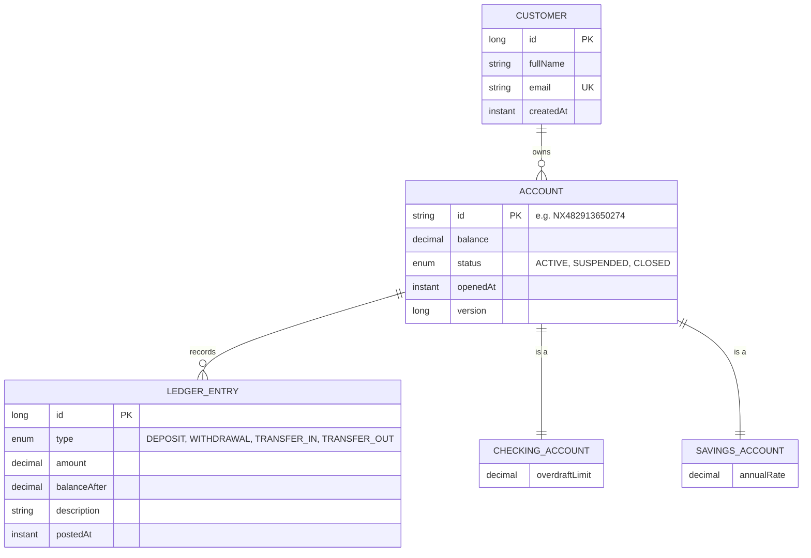

Both account kinds share one `accounts` table (single-table inheritance, discriminator `product_code`).

## Security

- Stateless: no server session, no CSRF surface. The console keeps the token in `sessionStorage`, so it disappears when the tab closes.
- HS256 tokens are signed with `nexabank.security.jwt-secret` (at least 32 bytes) and expire after `token-ttl-minutes`.
- `DELETE` routes require `ROLE_ADMIN`; everything else needs any signed-in user.
- CORS only allows the origins listed in `nexabank.security.allowed-origins`.
- **The built-in users and the default secret are for local demos only.** Override `NEXABANK_JWT_SECRET`, `NEXABANK_ADMIN_PASSWORD` and `NEXABANK_TELLER_PASSWORD` anywhere else, and replace the in-memory users with a real identity store before going live.

## Tour of the console

| | |
| --- | --- |
| 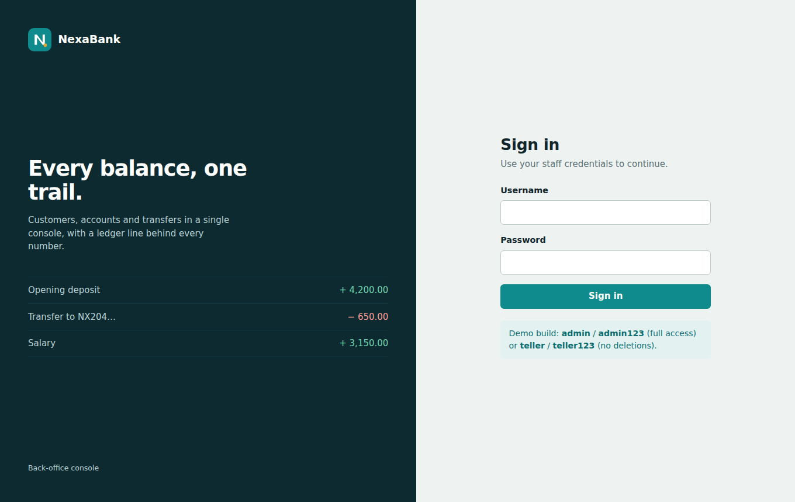 **Sign in** with role-aware access | 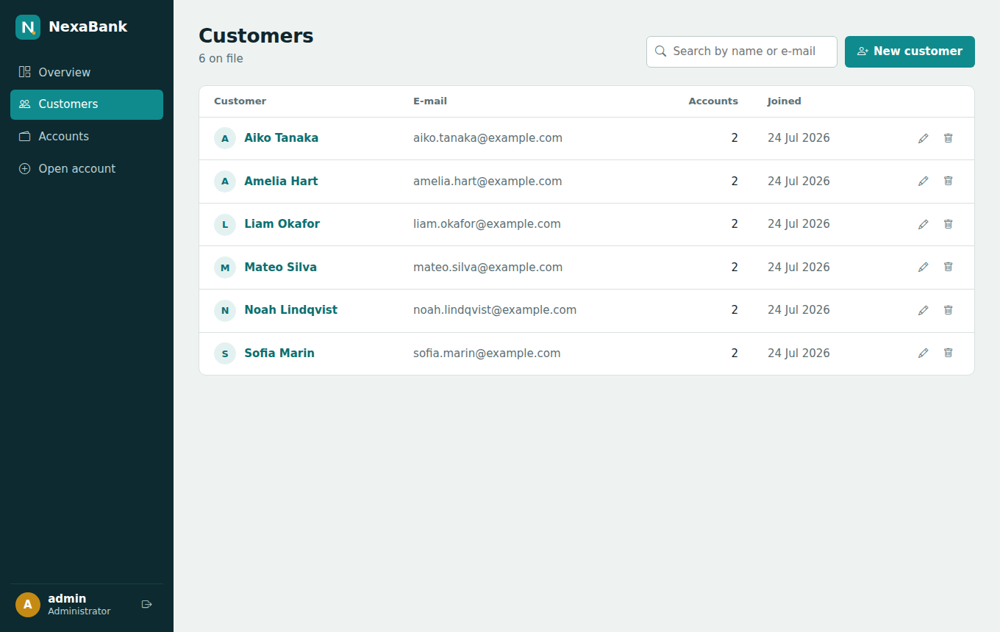 **Customers** with live search |
| 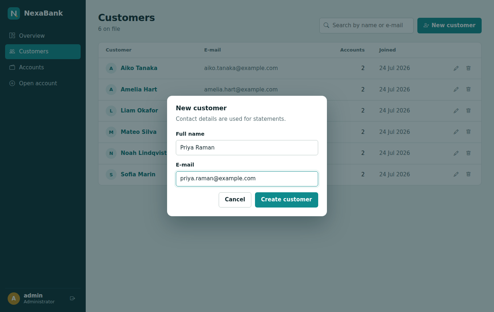 **Create or edit** in a native dialog | 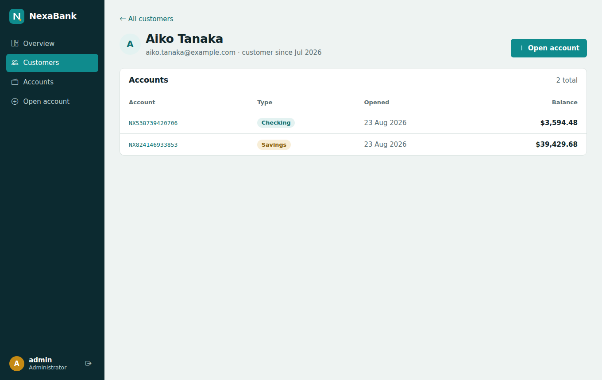 **Customer detail** with every account |
| 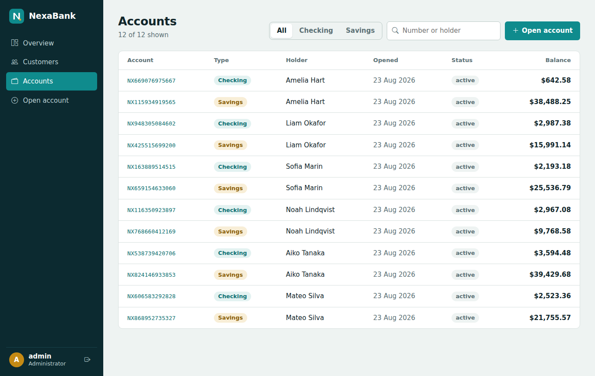 **Accounts** filtered by type or holder | 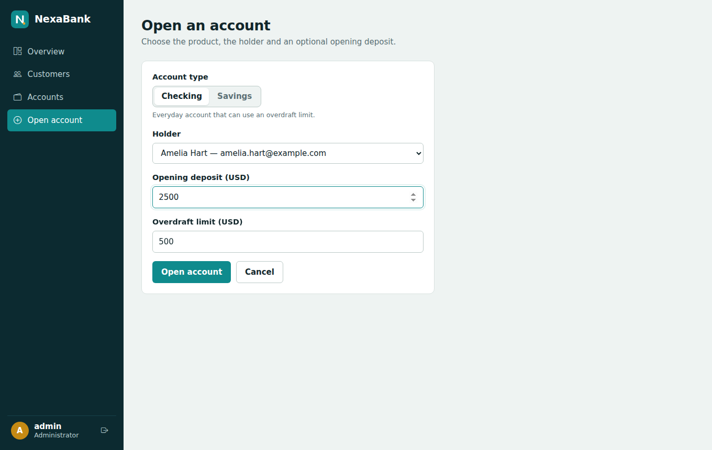 **Open an account** with product-specific fields |
| 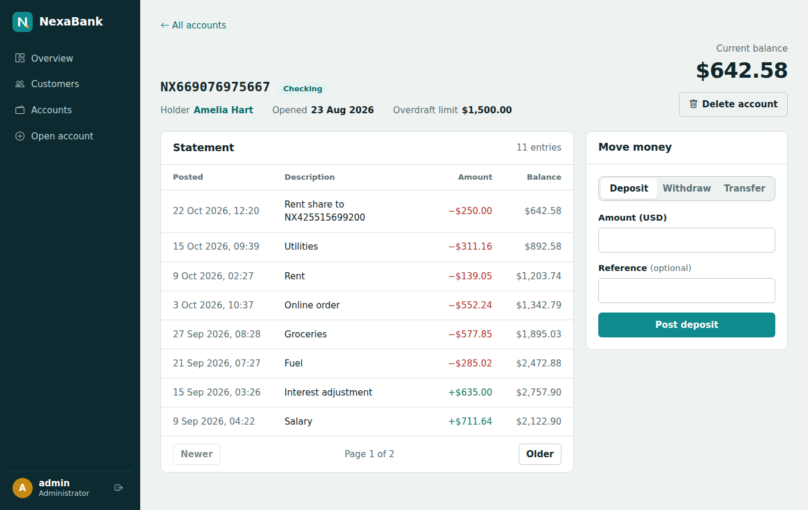 **Statement** with running balance | 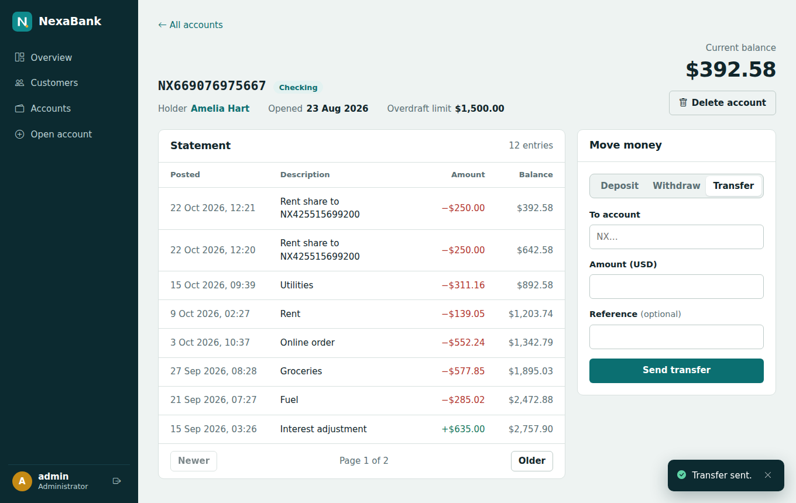 **Transfers** confirmed by a toast |
| 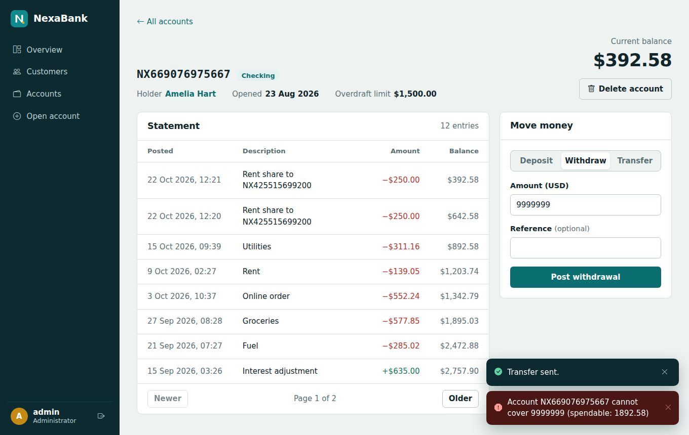 **Readable errors** from the API | 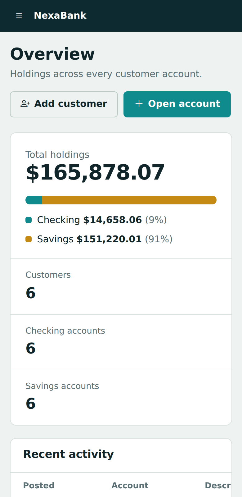<br>**Responsive** down to phone width |

## Configuration

| Property | Default | Meaning |
| --- | --- | --- |
| `server.port` | `8080` | API port |
| `nexabank.seed.enabled` | `true` (`false` with the `mysql` profile) | Insert demo customers on an empty database |
| `nexabank.security.jwt-secret` | dev value | HS256 signing key, env `NEXABANK_JWT_SECRET` |
| `nexabank.security.token-ttl-minutes` | `60` | Token lifetime |
| `nexabank.security.allowed-origins` | `http://localhost:4200` | CORS allow-list |
| `DB_HOST`, `DB_PORT`, `DB_NAME`, `DB_USER`, `DB_PASSWORD` | `localhost`, `3306`, `nexabank`, `nexabank`, `nexabank` | MySQL profile connection |

The console reads its API address from `frontend/src/environments/`.

## Testing

```bash
cd backend  && ./mvnw test      # domain rules, JWT login flow, secured endpoints
cd frontend && npm test         # Karma + Jasmine, headless Chrome
```
